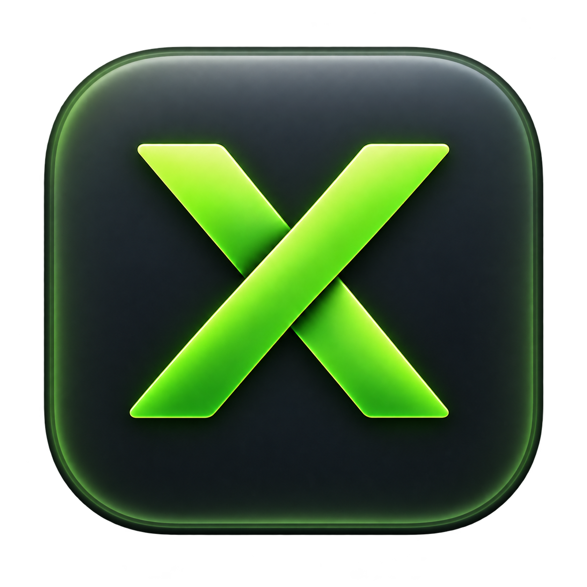

<p align="center">
  
</p>

<h1 align="center">XFrame</h1>

<p align="center">
  <strong>A native, ultra-low-latency Xbox Cloud Gaming &amp; Console Remote Play client for Apple Silicon Macs.</strong>
</p>

<p align="center">
  <a href="https://github.com/txchen/xframe/releases/latest"></a>
  
  
  
  
</p>

---

XFrame replaces heavy browser wrappers with a **~11 MB native Swift / Metal / VideoToolbox app** engineered from the ground up for Apple Silicon. Every frame travels zero-copy from VideoToolbox hardware decode straight into Metal, driven by a dedicated Mach real-time render worker, with built-in 4K upscaling (**MetalFX Spatial**, **AMD FSR 1**, **Integer Scaling**) and **live Core ML (ANE) + Metal 30 → 60 fps frame generation**.

## Install

### Homebrew (Recommended)

```sh
brew install --cask txchen/tap/xframe
```

To upgrade later:

```sh
brew upgrade --cask xframe
```

### Direct Download

Download the latest Developer ID signed &amp; Apple notarized ZIP from [**GitHub Releases**](https://github.com/txchen/xframe/releases/latest), unzip, and drag **XFrame.app** into `/Applications`.

> **Requirements:** Apple Silicon Mac (M1 or newer) running **macOS 27+**.

---

## Highlights

### Ultra-Low-Latency Streaming Pipeline
- **Zero-Copy Hardware Media**: Native WebRTC 153.0.0 H.264 transport → verified VideoToolbox hardware decode (`420v` NV12) → direct Metal surface import (~0.2–0.6 ms GPU).
- **Dedicated Real-Time Render Worker**: Runs Original, Integer, MetalFX Spatial, and FSR 1 on a `THREAD_TIME_CONSTRAINT_POLICY` thread with adaptive VSync lead and explicit `60–120 Hz` ProMotion support (measured **~7 ms lower local frame age** on M1 in matched A/B sessions).
- **WebRTC Zero Playout Delay**: Applies `WebRTC-ForcePlayoutDelay` (`min_ms:0,max_ms:0`), DSCP marking, and fast audio NetEq acceleration — reducing live receiver jitter buffer to **~0.6 ms** (toggleable in **View → Zero Playout Delay (WebRTC)**).
- **Zero-HOL-Blocking Input**: Event-driven immediate input flush over an unordered/unreliable xCloud input DataChannel (`useUnreliableInput`), plus automatic **macOS Game Mode** in fullscreen for 2× Bluetooth controller polling.
- **VRR / Adaptive Sync**: Optional **View → VRR / Adaptive Sync (Disable VSync)** mode for HDMI 2.1 VRR and FreeSync displays.

### 4K Upscaling &amp; Live Frame Generation
- **MetalFX Spatial + Sharpening**: Apple's perceptual spatial upscaler with optional fused luminance sharpening (`Off / Low / Medium / High`).
- **AMD FSR 1 (EASU + RCAS)**: Two-pass edge-adaptive spatial upsampling and contrast-adaptive sharpening in pure Metal.
- **Integer Scaling**: Pixel-exact integer enlargement in fullscreen (e.g., 1080p → 4K 2×, 720p → 4K 3×) with zero chroma/luma blur.
- **Live Core ML (ANE) + Metal 30 → 60 fps Frame Generation**: Runs optical-flow synthesis on the Apple Neural Engine + Metal with **bundled 2.8 MB weights** (zero download wait), duplicate-frame cadence detection for 30 fps games inside 60 Hz streams, scene-cut protection, and 60/120 Hz pacing.

### Controllers, Keyboard &amp; In-Game HUD
- **Multi-Controller Support**: Up to **4 simultaneous extended gamepads** (Xbox, DualSense/DualShock 4, etc.) with per-slot Core Haptics rumble and focus-safe release barriers.
- **Ready-to-Play Keyboard Mode**: Enabled by default with ergonomic physical-key bindings (`WASD` + Arrows + Xbox diamond `I/J/K/L` + `Left Shift` sprint), automatic device handoff when you touch a controller, and silenced unmapped keys (no macOS beep).
- **In-Picture Playback Settings (`Right-Click` / `F9` / `View + Menu`)**: Switch Scaling, Sharpening, Frame Generation, Performance Overlay, **live Frame Pacing** (`Balanced` / `Adaptive`), Audio Volume/Mute, Keyboard Input, Rumble, Fullscreen, and confirmed End Session without leaving the stream.
- **Playback Comfort**: Automatic display sleep prevention (`IOPMAssertion`) during active playback and fullscreen cursor auto-hide after 2.5 s of inactivity.

### xCloud Library &amp; LAN Xbox Console Remote Play
- **Fast Cloud Library**: 7-day local catalog metadata cache, 30-day local poster artwork disk cache, **Recently Played**, **Favorites**, entitlement-aware filtering, region picker, game language selection, custom max bitrate cap, and automatic background token renewal for long sessions.
- **LAN Xbox Series X|S Remote Play**: SmartGlass multi-subnet LAN discovery, Wake from Standby, and strict same-subnet direct-ICE enforcement (relayed/external paths are blocked).

### Built-In Diagnostics &amp; Offline Benchmark
- **Performance Overlay (`F6` / `⇧⌘D`)**: Compact, Detailed, and Hidden presets showing 2-second Stream/Output FPS, bitrate, RTT, receiver buffer, per-stage p95 timings (`Decode`, `Frame wait`, `GPU`, `Display wait`, `Arrival → display`), and separate generated-frame counts.
- **Sanitized Diagnostics Export**: Export bounded JSON timing reports with an explicit allowlist (never includes credentials, gamertags, titles, SDP, or IP addresses).
- **Post-Processing Benchmark (`⇧⌘B`)**: Built-in offline benchmark for MetalFX Spatial, VideoToolbox, and Core ML ANE frame generation on your Mac.

---

## Architecture

```text
xCloud / LAN Xbox (WebRTC H.264 + Opus + DataChannels)
  │
  ├─ Video RTP ──▶ HardwareH264Decoder (VideoToolbox NV12, zero pixel copy)
  │                     │
  │                     ▼
  │               LiveVideo (Balanced 2-frame / Adaptive 4-frame RTP pacer)
  │                     │
  │                     ▼
  │         OriginalPresenter (Mach RT worker, adaptive VSync lead, 60–120 Hz)
  │         or MetalRenderer (MTKView + LiveFrameInterpolator ANE + Metal)
  │                     │
  │                     ▼
  │         Original / Integer / MetalFX Spatial / FSR 1 (EASU + RCAS)
  │                     │
  │                     ▼
  │              CAMetalLayer (Actual presentedTime telemetry)
  │
  ├─ Audio RTP ──▶ WebRTC Native Audio Output (independent mute/volume, fast NetEq)
  └─ Input DC  ──▶ Event-driven Gamepad (up to 4 slots) / Keyboard ──▶ Unordered SCTP
```

---

## Controls &amp; Shortcuts

### Playback Quick Shortcuts

| Shortcut | Menu Equivalent | Action |
|---|---|---|
| **`F6`** | `⇧⌘D` | Cycle Performance Overlay (`Compact → Detailed → Hidden`) |
| **`F7`** | `⇧⌘S` | Cycle Video Scaling (`Original → Integer → MetalFX → FSR 1`) |
| **`F8`** | `⇧⌘I` | Cycle Frame Generation (`Off → Core ML Balanced → Core ML Quality`) |
| **`F9`** | `⇧⌘P` | Toggle In-Picture Playback Settings HUD (or `Right-Click` / `View + Menu`) |
| **`⌃⌘F`** | View → Toggle Full Screen | Toggle Native Full Screen (activates macOS Game Mode) |
| **`⌘0`** | File → End Session | Open End Session / Disconnect confirmation |

### Keyboard Gamepad Mapping (Physical ANSI Positions)

| Xbox Control | Keys |
|---|---|
| Left Stick (Move) | `W` `A` `S` `D` |
| Right Stick (Look) | Arrow Keys (`↑` `↓` `←` `→`) |
| `Y` / `X` / `A` / `B` | `I` / `J` / `K` / `L` &nbsp;*(aliases: `Space`=A, `Backspace`=B, `R`=X, `F`=Y)* |
| `LB` / `RB` | `Q` / `E` |
| `LT` / `RT` | `U` / `O` |
| `LS` (Sprint) / `RS` | `Left Shift` / `V` |
| D-Pad (Up / Down / Left / Right) | `1` / `2` / `3` / `4` |
| `Menu` / `View` | `Return` / `Tab` |

---

## Building from Source

Requires an Apple Silicon Mac with **Swift 6.4** and the **macOS 27 SDK** (Command Line Tools or Xcode).

```sh
# Build signed development app bundle (.build/XFrame.app)
bash scripts/build-app.sh
open .build/XFrame.app

# Run the full automated test suite (239 tests)
bash scripts/test.sh
```

For reproducible Developer ID signing and notarization, see [`docs/distribution.md`](docs/distribution.md).

---

## Privacy, Security &amp; Account Storage

- **Zero Telemetry**: XFrame communicates only with Microsoft / Xbox authentication, catalog, and streaming endpoints (plus GitHub Releases if you run the optional offline benchmark video download).
- **Local Credentials**: Only the Microsoft refresh token is persisted on disk at `~/Library/Application Support/XFrame/Credentials/microsoft-refresh-token` with strict owner-only permissions (`0700` directory, `0600` file, symlink/permission checks on read). Signing out deletes the local token file.
- **Public Client Notice**: Authentication uses Microsoft's public device-code flow (matching [XStreaming's](https://github.com/Geocld/XStreaming) public client identifier). XFrame is an independent open-source project and is not affiliated with Microsoft or Xbox.
- **LAN Console Safety**: Xbox Console Remote Play enforces host-only UDP ICE candidates on the same physical IPv4 subnet; relayed or non-LAN paths are rejected.

---

## Research &amp; Technical Docs

- [Original Render Worker Latency Acceptance (R2)](docs/research/original-render-latency/acceptance-results-r2.md)
- [xCloud WebRTC Protocol &amp; Resolution Findings](docs/research/xcloud-webrtc-protocol-findings.md)
- [HDR Streaming Research (Apple Silicon EDR / 10-bit PQ)](docs/research/hdr-streaming-research.md)
- [Distribution, Signing &amp; Notarization Guide](docs/distribution.md)
- [Third-Party Notices](THIRD_PARTY_NOTICES.md)
