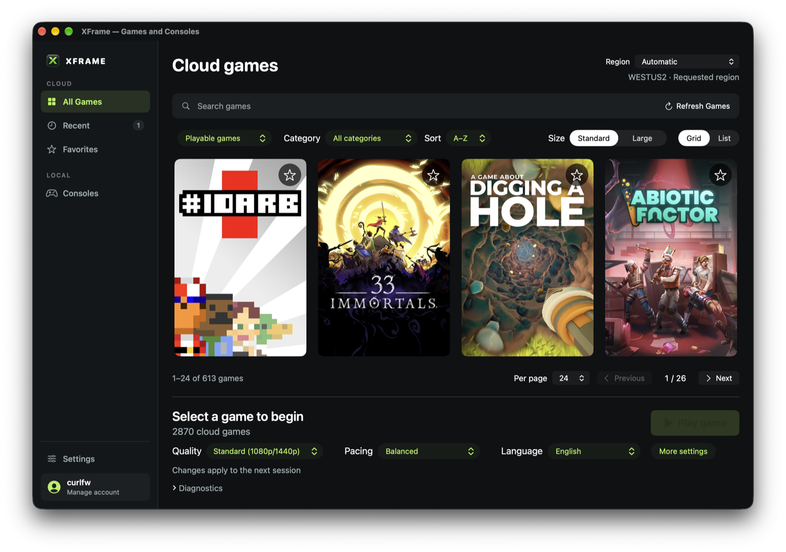

<p align="center">
  
</p>

<h1 align="center">XFrame</h1>

<p align="center">
  <strong>A native, ultra-low-latency Xbox Cloud Gaming &amp; Console Remote Play client for Apple Silicon Macs.</strong>
</p>

<p align="center">
  <a href="https://github.com/txchen/xframe/releases/latest"></a>
  
  
  
</p>

<p align="center">
  
</p>

---

## Install

```sh
brew install --cask txchen/tap/xframe
```

Or download the latest Developer ID signed &amp; Apple notarized ZIP (~11 MB) from [**GitHub Releases**](https://github.com/txchen/xframe/releases/latest).

> Requires an Apple Silicon Mac running **macOS 27+**.

---

## Why XFrame?

No Electron, no browser overhead — just a **~11 MB native Swift, Metal, and VideoToolbox app** built specifically for Apple Silicon:

- **Ultra-Low Latency**: Zero-copy VideoToolbox H.264 decode → Metal NV12 (~0.2–0.6 ms GPU), a dedicated Mach real-time render worker with `60–120 Hz` ProMotion support (~7 ms lower frame age on M1), WebRTC Zero Playout Delay (~0.6 ms receiver buffer), unordered xCloud input channel, VRR/Adaptive Sync option, and automatic **macOS Game Mode** in fullscreen.
- **4K Upscaling**: Switch live between **MetalFX Spatial** (+ sharpening), **AMD FSR 1 (EASU + RCAS)**, pixel-exact **Integer Scaling**, and **Original**.
- **Built-In Live 30 → 60 fps Frame Generation**: Runs Core ML (Apple Neural Engine) + Metal optical-flow synthesis with **bundled 2.8 MB weights** (works offline out of the box), duplicate-frame detection for 30 fps games in 60 Hz streams, and scene-cut protection.
- **Seamless Controllers &amp; Keyboard**: Up to **4 simultaneous controllers** with per-slot Core Haptics rumble, plus ready-to-play keyboard controls (`WASD` + Arrows + `I/J/K/L` + `Left Shift` sprint) with instant automatic handoff.
- **xCloud + LAN Xbox Console Remote Play**: Fast locally-cached library with **Recently Played**, **Favorites**, custom bitrate cap, long-session auto token renewal, plus LAN-only Xbox Series X|S streaming with SmartGlass discovery and Wake.
- **In-Game HUD &amp; Benchmark**: Real-time Compact/Detailed performance overlay, sanitized JSON diagnostics export, and a built-in MetalFX / VideoToolbox / Core ML ANE benchmark (`⇧⌘B`).

---

## Quick Shortcuts

| Key | Action |
|---|---|
| **`F6`** / `⇧⌘D` | Cycle Performance Overlay (`Compact → Detailed → Hidden`) |
| **`F7`** / `⇧⌘S` | Cycle Video Scaling (`Original → Integer → MetalFX → FSR 1`) |
| **`F8`** / `⇧⌘I` | Cycle Frame Generation (`Off → Balanced → Quality`) |
| **`F9`** / `⇧⌘P` / `Right-Click` | Open In-Game Playback Settings (Scaling, Pacing, Volume, Audio, End Session) |
| **`⌃⌘F`** | Toggle Full Screen (macOS Game Mode + auto-hide cursor) |

---

## Build from Source

```sh
bash scripts/build-app.sh && open .build/XFrame.app
bash scripts/test.sh   # 239 automated tests
```

## Privacy &amp; Docs

- **Zero telemetry.** Refresh tokens are stored locally with owner-only (`0600`) permissions; diagnostic exports strip all credentials, titles, and IPs. Independent open-source project, not affiliated with Microsoft or Xbox.
- **Technical docs**: [Latency Research (R2)](docs/research/original-render-latency/acceptance-results-r2.md) · [xCloud WebRTC Findings](docs/research/xcloud-webrtc-protocol-findings.md) · [HDR Research](docs/research/hdr-streaming-research.md) · [Distribution](docs/distribution.md) · [Notices](THIRD_PARTY_NOTICES.md)
